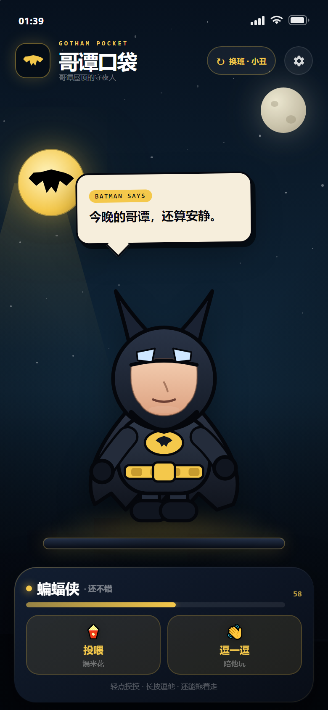
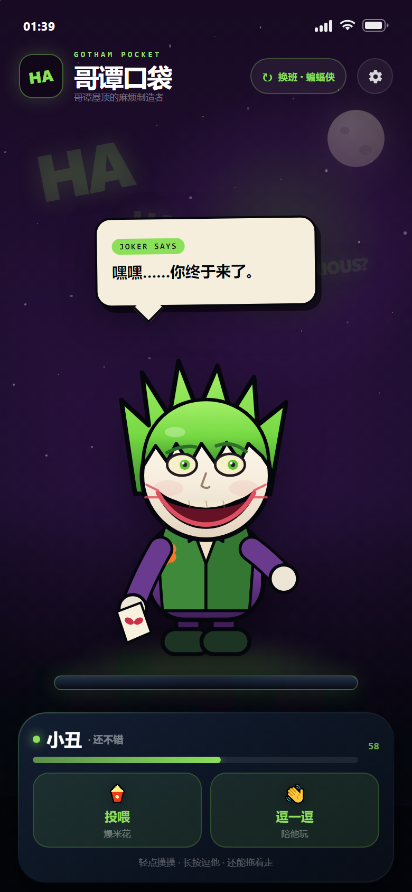
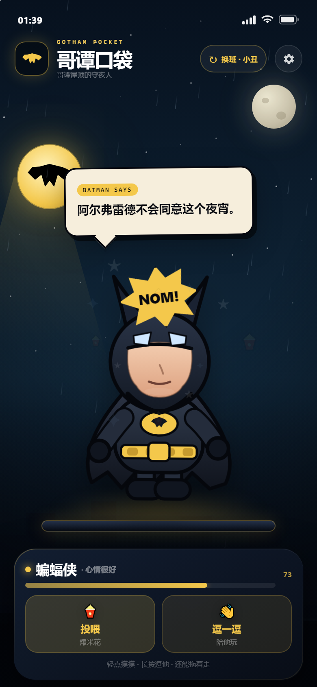
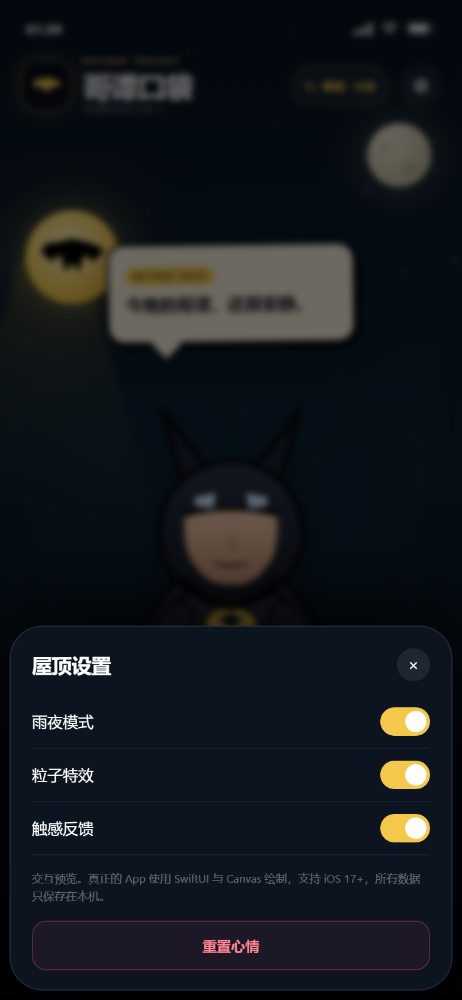

# 哥谭口袋 · Gotham Pocket

一个极简的 iPhone 桌面小宠：蝙蝠侠和小丑住在哥谭的屋顶上。

项目包含完整的 SwiftUI 源码、App 图标、XcodeGen 工程描述，以及一个可以直接在 GitHub 上构建未签名 `.ipa` 的 Actions 工作流。

以下是交互预览的截图：

<p>
  
  
  
  
</p>

## 功能

- 两只可切换的小宠：蝙蝠侠 / 小丑
- 轻点摸摸：随机台词 + 心情 +2
- 长按逗他：特殊反应 + 心情 +5
- 拖动宠物：松手会弹回屋顶
- 投喂爆米花 / 陪他玩：心情提升，并触发漫画粒子特效
- 心情值与台词本地保存
- 设置：雨夜模式、粒子特效、触感反馈、重置心情
- 纯离线，无广告、无内购、不联网

> iOS 不允许普通 App 悬浮在其他 App 上方，所以这是一只“住在 App 里”的桌面宠物；打开哥谭口袋，它就在屋顶上等你。

## 环境

- iOS 17.0+
- Xcode 15 或 16
- [XcodeGen](https://github.com/yonaskolb/XcodeGen)：`brew install xcodegen`

## 在 Mac 上运行

```bash
# 在本项目根目录（README 所在目录）
xcodegen generate
open GothamPocket.xcodeproj
```

在 Xcode 里选择 `GothamPocket` target：

1. `Signing & Capabilities` 里选择你的 Apple ID Team。
2. 把 Bundle Identifier 从 `com.gothampocket.app` 改成你自己的，例如 `com.yourname.gothampocket`。
3. 连接 iPhone，选择真机，点 Run。

免费 Apple ID 也可以安装，签名有效期 7 天，到期重新运行一次即可。

## 生成未签名 IPA

Mac 上：

```bash
bash scripts/build-ipa.sh
```

输出：

```text
dist/GothamPocket-1.0-unsigned.ipa
dist/GothamPocket-1.0-unsigned.ipa.sha256
```

这个 IPA 未签名，不能直接双击安装。用 [Sideloadly](https://sideloadly.io/) 或 [AltStore](https://altstore.io/) 导入，登录你的 Apple ID 完成签名后安装。

## 没有 Mac：用 GitHub Actions 构建

详细步骤见 [GITHUB_BUILD.md](GITHUB_BUILD.md)。

1. 新建一个 GitHub 仓库。
2. 把这个文件夹里的内容上传到仓库根目录（`project.yml` 要在根目录）。
3. 打开仓库的 **Actions** 页面，选择 **Build unsigned IPA**，点 **Run workflow**。
4. 构建完成后，在运行记录的 **Artifacts** 里下载 `GothamPocket-unsigned-ipa`。
5. 解压得到 `.ipa`，再用 Sideloadly / AltStore 签名安装。

工作流使用 `macos-15`，会自动安装 XcodeGen、编译、打包并计算 SHA-256。通常 5–10 分钟完成。

## 工程结构

```text
GothamPocket/
├── GothamPocket/
│   ├── App/                 # App 入口
│   ├── Models/              # 角色、台词、配色
│   ├── Store/               # 心情、设置、本地存储、粒子状态
│   ├── Views/               # 主界面、角色 Canvas、天空、气泡、设置
│   ├── Theme/               # 颜色
│   ├── Support/             # 触感反馈
│   └── Resources/           # AppIcon / AccentColor
├── Support/Info.plist
├── project.yml              # XcodeGen 工程配置
├── scripts/build-ipa.sh     # Mac 打包脚本
└── .github/workflows/       # GitHub Actions 云端构建
```

## 想改点什么

- **角色台词**：`GothamPocket/Models/Companion.swift`
- **配色**：`GothamPocket/Theme/GothamTheme.swift` 和 `Companion.swift`
- **App 名称**：`Support/Info.plist` 里的 `CFBundleDisplayName`
- **Bundle ID**：`project.yml` 里的 `PRODUCT_BUNDLE_IDENTIFIER`
- **图标**：替换 `GothamPocket/Resources/Assets.xcassets/AppIcon.appiconset/AppIcon.png`，尺寸 1024×1024，不要带透明通道

网页版交互预览在 `preview/index.html`，可以直接用浏览器打开。它只用于展示视觉效果，不是真正的 iOS App。

## 说明

这是一个非官方、非商业的同人作品。蝙蝠侠与小丑的相关权利归 DC Comics 所有；本项目不包含任何官方图片、音频或字体素材，角色均由 SwiftUI Canvas 和 SVG 手工绘制。

本项目没有在真实 Mac / iPhone 上完成最终编译验证；SwiftUI 源码按 iOS 17 API 编写，首次 Xcode 构建如遇 SDK 差异，请以 Xcode 报错为准微调。IPA 的签名和安装需要你自己的 Apple ID。
